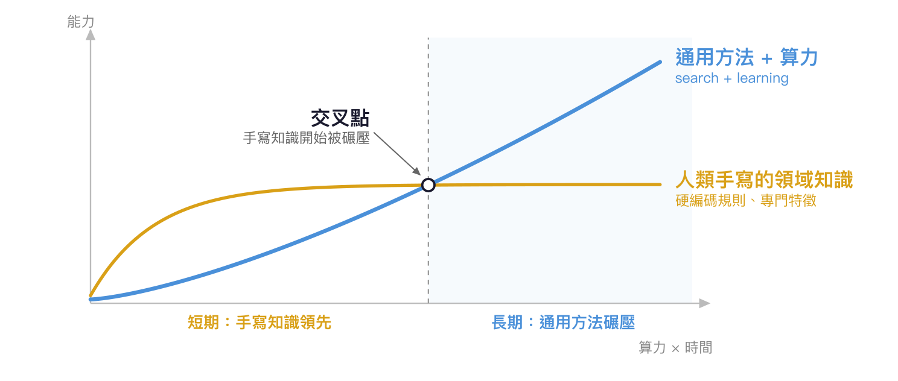
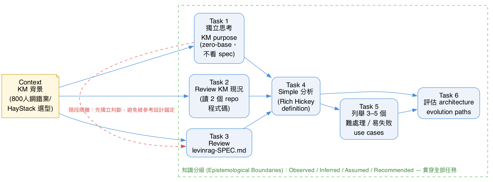

<!-- _class: lead -->

# 降低 Agent 的搜尋成本

---

# Outlines

- The Bitter Lessons
- 強迫 Agent 換 tool -- 省時省 token
- Monorepo
- 改善 Ground Truth 的觸及
- Reasoning Protocol

---

# The Bitter Lessons

> 所有試圖把**人類手寫的領域知識**塞進 AI 的方法，長遠來看都會被「**通用搜尋 + 巨量算力**」碾壓。

- 能**無限**吃算力的只有兩件事：**search** 與 **learning**
- 接下來談的技巧不是要塞 domain knowledge 給模型，而是要降低 agent 在 tool use / context 上的搜尋成本，本質上是在幫 agent 更快找到**通用搜尋的路徑**。

---

# 強迫 Agent 換 tool -- 省時省 token

* 挑戰：現代 CLI 工具（`rg`、`fd`、`sd`、`jq`）取代傳統 CLI（`grep`、`find`、`sed`）
* 解法：PreToolUse Hook

---

# Monorepo -- 消除人工製造的搜尋邊界

* 挑戰：程式碼被切成 N 個 repo，agent 內建的通用工具只看得到當下 checkout 的那一個
* 代價：跨 repo 的依賴關係得靠人工先告訴 agent「這段邏輯在另一個 repo」—— 等於重新塞了一個人工 heuristic 回去
* 解法：Monorepo 讓 agent 的通用搜尋工具原生可達整個依賴圖，不需要人工中介

---

# 改善 Ground Truth 的觸及

* 安裝 skills or extensions
  * superpowers
  * context-7
* superpowers 針對 agent 工作流程的三個階段分別提供 ground truth：理解需求（user intention）、開發驗證（TDD）、出錯排除（debug）
* context-7 => 最新版本 API 文件與程式碼範例的 ground truth 
* **Tip**: 有 bug 解不出來時，主動提醒 Agent 要用 `/systematic-debugging`

---

# Reasoning Protocol

- 挑戰：架構是隱性知識，不容易看出來。
- Reasoning Protocol (RP) 不是單純的 CoT (chain of thought)，而是透過人為設計的認知框架，在推理過程中做到：
  - **階段隔離**（Cognitive Segregation）
  - **知識分級**（Epistemological Boundaries）
  - 以**有向無環圖** (DAG) 的拓樸結構編排運算路徑

---

# Reasoning Protocol — Example

* Prompt：`arch-review-prompt.md`（KM 專案 architecture review）

---

# Reference

- Sumers et al., *Cognitive Architectures for Language Agents* (CoALA)
  [arxiv.org/abs/2309.02427](https://arxiv.org/abs/2309.02427)